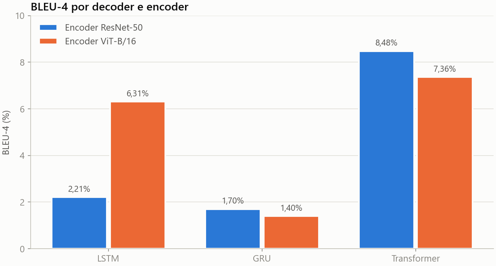
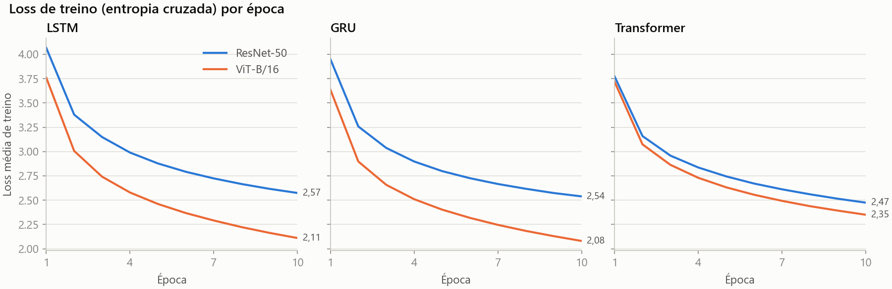

# Legendas automáticas: LSTM vs. GRU vs. Transformer

Geração de legendas em inglês para imagens do Flickr8k, comparando três decoders (LSTM, GRU e Transformer) sobre dois encoders pré-treinados (ResNet-50 e ViT-B/16).

> Trabalho da disciplina *Tópicos Especiais em Matemática Aplicada: Deep Learning* (UnB, 2025), feito em grupo. Veja [Autores](#autores).

## Resultados

| Encoder | Decoder | Loss de treino (época 10) | BLEU-4 |
| :--- | :--- | :---: | :---: |
| ResNet-50 | LSTM | 2,5742 | 2,21% |
| ResNet-50 | GRU | 2,5389 | 1,70% |
| ResNet-50 | **Transformer** | 2,4747 | **8,48%** |
| ViT-B/16 | LSTM | 2,1110 | 6,31% |
| ViT-B/16 | GRU | 2,0807 | 1,40% |
| ViT-B/16 | **Transformer** | 2,3501 | **7,36%** |

**Como ler os números:**

- O BLEU foi medido em 4.800 pares imagem-legenda sorteados do **próprio conjunto de treino**, com **uma** legenda de referência por imagem, embora o Flickr8k tenha cinco. Por isso os valores são baixos em termos absolutos e servem só para comparar as combinações entre si.
- As duas execuções não diferem só no encoder: mudam também o `hidden_size` das RNNs, o scheduler, a augmentation e o treino da projeção (veja [Abordagem](#abordagem)). A coluna "Encoder" é, na prática, o conjunto de cada configuração.
- Em testes preliminares, a equipe observou picos de cerca de 10% de BLEU com ViT-B/16 e Transformer, que não se repetiram na execução final. Reportamos o resultado estável de 7,36%.

## O que aprendemos

- **O decoder Transformer foi o melhor nas duas configurações** (8,48% e 7,36%), à frente de LSTM e GRU. É o resultado mais consistente do trabalho, ainda que a avaliação tenha as limitações descritas abaixo.
- **Loss de treino baixa não garante legenda boa.** Com o ViT-B/16, o GRU teve a menor loss (2,0807) e o pior BLEU (1,40%). Isso sugere que minimizar a entropia cruzada palavra a palavra não basta para gerar frases parecidas com as de referência. Fica como hipótese: as falhas de avaliação descritas abaixo afetam mais as RNNs e podem explicar parte da diferença.
- **A avaliação é parte do modelo.** Ao revisar o código para esta publicação, encontramos problemas no protocolo de avaliação (dados de treino, uma referência, decodificação das RNNs, encoder compartilhado) que pesam mais nos números do que a escolha de arquitetura. Este é o principal aprendizado do trabalho.

## Dataset

[Flickr8k](https://www.kaggle.com/datasets/adityajn105/flickr8k): cerca de 8,1 mil imagens do Flickr, cada uma com 5 legendas em inglês escritas por pessoas. O download é feito no próprio notebook via `kagglehub`, e as imagens não são redistribuídas aqui.

O vocabulário guarda as palavras que aparecem ao menos 5 vezes nas legendas: 2.994 tokens, incluindo `<PAD>`, `<SOS>`, `<EOS>` e `<UNK>`.

## Abordagem

O encoder pré-treinado e congelado transforma cada imagem em um vetor de 256 dimensões. O decoder gera a legenda palavra por palavra a partir desse vetor. O treino usa teacher forcing e entropia cruzada (ignorando `<PAD>`), com Adam (lr 3e-4), 10 épocas e batch 32. A geração é gulosa, com até 20 tokens, e a métrica é o BLEU-4 do TorchMetrics.

| | [Notebook 01](notebooks/01_encoder_resnet50.ipynb): ResNet-50 | [Notebook 02](notebooks/02_encoder_vit_b16.ipynb): ViT-B/16 |
| :--- | :--- | :--- |
| Vetor da imagem | Pooling da ResNet-50 (2048) → linear → 256 | Token de classe do ViT-B/16 (768) → linear → 256 |
| Projeção para 256 | Não treinada na prática (veja Limitações) | Treinada e compartilhada pelos três decoders |
| LSTM e GRU | 1 camada, `hidden_size` 256 | 1 camada, `hidden_size` 512 |
| Transformer | 1 camada, 4 cabeças, d = 256 | Igual |
| Scheduler | Nenhum | `ReduceLROnPlateau` |
| Augmentation | Nenhuma | Recorte, espelhamento e variação de brilho e contraste |
| GPU (Colab) | L4 | L4 |

Nas RNNs, o vetor da imagem entra como primeiro passo da sequência. No Transformer, ele é a memória da atenção cruzada: como é um único vetor, a atenção cruzada não escolhe regiões da imagem.

Os notebooks guardam as saídas da execução original. Para esta versão, foram removidos caminhos pessoais, warnings, testes de formato, código duplicado e os logs por passo, mantendo a loss média de cada época. Nenhum resultado foi alterado.

## Fundamentos

Teoria resumida: encoder-decoder, LSTM, GRU, Transformer e BLEU

### Encoder-decoder

A legenda é modelada como a probabilidade de uma sequência de palavras dada a imagem, decomposta pela regra da cadeia: cada palavra depende da imagem e das palavras anteriores. O **encoder** (aqui, uma rede de visão pré-treinada) resume a imagem em um vetor. O **decoder** gera a legenda de forma autorregressiva até produzir `<EOS>`.

### Decoders

- **LSTM:** RNN com uma célula de memória controlada por três portões (esquecimento, entrada e saída), que reduz o problema do gradiente que desaparece em sequências longas.
- **GRU:** versão simplificada da LSTM, com dois portões (atualização e reset) e um único estado. Tem menos parâmetros e costuma treinar mais rápido.
- **Transformer:** troca a recorrência por atenção. A autoatenção mascarada relaciona cada palavra às anteriores, a atenção cruzada consulta a representação da imagem, e o positional encoding informa a ordem das palavras.

### Atenção visual

Em modelos como *Show, Attend and Tell*, o encoder entrega um mapa de regiões, e o decoder escolhe em quais regiões focar a cada palavra. Este trabalho usa um único vetor global por imagem, então não há atenção sobre regiões.

### BLEU

O BLEU mede quantos n-gramas (sequências de 1 a 4 palavras) da legenda gerada aparecem nas legendas de referência. O resultado é uma média geométrica das precisões de n-gramas, multiplicada por uma penalidade para legendas curtas demais. Vai de 0 a 1 (ou 0 a 100%), e o valor depende muito do número de referências usadas.

## Limitações e próximos passos

**Limitações**

- **Avaliação no treino:** não há conjunto de teste separado. O BLEU foi calculado em lotes do `train_loader`, que no ViT-B/16 ainda aplica a augmentation de treino.
- **Uma referência por imagem:** cada par usa só a legenda sorteada no lote, e não as cinco disponíveis, o que reduz o BLEU de todos os modelos.
- **Decodificação das RNNs:** no treino, a sequência é `[imagem, <SOS>, palavras…]`, e a saída da posição da imagem é descartada. Na geração, o primeiro token sai justamente dessa posição, que nunca foi supervisionada, e o `<SOS>` não é fornecido. Isso prejudica LSTM e GRU, mas não o Transformer.
- **Encoder compartilhado (ViT-B/16):** a projeção do encoder continuou treinando com cada decoder, na ordem Transformer, GRU e LSTM, e a avaliação só aconteceu no fim. O LSTM foi avaliado com a projeção que acabou de ajustar; o Transformer e o GRU, não.
- **Projeção sem treino (ResNet-50):** o encoder roda dentro de `torch.no_grad()`, então a camada que leva o vetor de 2048 para 256 dimensões nunca recebe gradiente e fica com os pesos iniciais.
- **Poucas épocas e uma execução:** 10 épocas por modelo, sem seed fixa e sem repetição, então diferenças pequenas entre os BLEU podem ser ruído.

**Próximos passos**

1. Separar treino, validação e teste (por exemplo, o split de Karpathy) e avaliar só no teste.
2. Calcular o BLEU com as cinco referências e acrescentar métricas como METEOR e CIDEr.
3. Corrigir a geração das RNNs para começar por `<SOS>` e usar um encoder independente por decoder.
4. Usar os tokens de patch do ViT ou o mapa de características da ResNet como memória, para haver atenção sobre regiões.
5. Treinar por mais épocas, com seed fixa e várias execuções, e testar beam search.

## Autores

Eliseu Kadesh, Pedro Barbosa e Raquel Eucaria.

Trabalho desenvolvido em grupo na disciplina *Tópicos Especiais em Matemática Aplicada: Deep Learning*, ministrada pelo Prof. Vinicius Rispoli na Faculdade de Ciências e Tecnologias em Engenharia (UnB Gama), em 2025.

## Licença

O código está sob a licença [MIT](LICENSE), que não cobre o dataset Flickr8k nem os pesos pré-treinados.

## Referências

- Hodosh, M.; Young, P.; Hockenmaier, J. [Framing Image Description as a Ranking Task](https://www.jair.org/index.php/jair/article/view/10833) (Flickr8k). JAIR, 2013.
- Vinyals, O. et al. [Show and Tell: A Neural Image Caption Generator](https://arxiv.org/abs/1411.4555). 2015.
- Xu, K. et al. [Show, Attend and Tell](https://arxiv.org/abs/1502.03044). 2015.
- Hochreiter, S.; Schmidhuber, J. Long Short-Term Memory. *Neural Computation*, 1997.
- Cho, K. et al. [Learning Phrase Representations using RNN Encoder-Decoder](https://arxiv.org/abs/1406.1078). 2014.
- Vaswani, A. et al. [Attention Is All You Need](https://arxiv.org/abs/1706.03762). 2017.
- Papineni, K. et al. [BLEU: a Method for Automatic Evaluation of Machine Translation](https://aclanthology.org/P02-1040/). ACL, 2002.
- He, K. et al. [Deep Residual Learning for Image Recognition](https://arxiv.org/abs/1512.03385). 2015.
- Dosovitskiy, A. et al. [An Image is Worth 16x16 Words](https://arxiv.org/abs/2010.11929). 2020.
- IBM. [Encoder-decoder model](https://www.ibm.com/think/topics/encoder-decoder-model). Acesso em: 4 dez. 2025.
